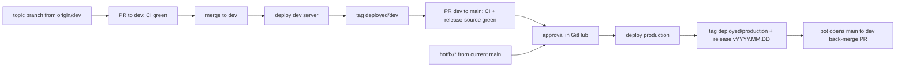

# CI/CD for the validator

**Proposal:** the validator deploys from GitHub Actions after every merged PR. A merge into
`dev` deploys the dev server automatically. A merge into `main` deploys production after one
approval in GitHub. Every deploy is recorded as a git tag, and every production deploy is a
GitHub Release with generated release notes. At any time, the tags show which commit each
environment runs.

The website has its own CI/CD and is not covered here. The one point where the two meet is
the API contract (section 6).

Status, 2026-10-19: the dev-server deploy (phase 2) is implemented. It consists of
[`.github/workflows/deploy.yml`](../../.github/workflows/deploy.yml), the server script and setup
guide in [`deploy/ci/`](../../deploy/ci/README.md), and `just deploy-up`. It goes live once the
server and the `dev` environment are set up. The production phases are still a proposal. The
rules for contributors and coding agents are in [`../DEPLOYING.md`](../DEPLOYING.md).

---

## 1. Starting point

- Deploys are done over SSH on each server: a checkout in `/opt/conjectures-validator/current`,
  then `just up`, or a rebuild of the `api` service.
- [`ci.yml`](../../.github/workflows/ci.yml) runs ruff, pytest against Postgres, and the
  schema-drift proof on every PR and on pushes to `main`.
- `origin/main` currently has 7 commits that `origin/dev` does not. Merging them into `dev`
  is the first step (phase 0), so both branches start level.
- The repository is public. Everything this plan uses (hosted runners, environments with
  required reviewers, environment secrets, rulesets, releases) is free for public
  repositories.

## 2. Target flow

| | Dev server | Production server |
| --- | --- | --- |
| Branch | `dev` | `main` |
| Network | testnet, netuid 577 | mainnet, netuid 66 |
| Checkout | `/opt/conjectures-validator/current` | `/opt/conjectures-validator/current` |
| Deployed on | merge into `dev`, automatically | merge into `main`, after one approval |
| Recorded as | tag `deployed/dev` | tag `deployed/production` + release tag `vYYYY.MM.DD[.N]` with a GitHub Release |



Repository rules:

1. `dev` and `main` accept changes only through a PR with green checks. No direct pushes,
   no force-pushes, no deletion.
2. `main` accepts PRs only from `dev` and from `hotfix/*`.
3. A `hotfix/*` branch starts from the current `main`.
4. After every merge into `main`, a workflow opens a `main` → `dev` PR if `main` has
   something `dev` does not.
5. A `dev` → `main` PR is red while `main` has commits that `dev` lacks.
6. `dev` → `main` and back-merge PRs use **"Create a merge commit"**. A squash would give
   `main` commits whose SHAs `dev` never has, and rule 5 would stay red. Topic PRs into
   `dev` may squash.
7. The pipeline itself (`.github/`, `deploy/`, the justfile's deploy recipes, the deploy
   script) has CODEOWNERS, so a change to how deploys work always gets an owner's review.

Rules 2, 3 and 5 are enforced by a `release-source` job in CI, made a required check on
`main`. A ruleset cannot restrict the source branch on its own. The job:

```bash
# pull_request with base main
case "$HEAD_REF" in
  dev)       test -z "$(git rev-list --no-merges origin/dev..origin/main)" ;;   # rule 5
  hotfix/*)  git merge-base --is-ancestor origin/main HEAD ;;                  # rule 3
  *)         echo "main accepts PRs only from dev or hotfix/*"; exit 1 ;;      # rule 2
esac
```

`--no-merges` ignores the merge commit every release leaves on `main` (rule 6). Only real
changes count.

## 3. How a deploy runs

```mermaid
sequenceDiagram
  participant GH as GitHub Actions
  participant Srv as Server (forced command)
  GH->>GH: CI (push) or skip (redeploy of a release tag)
  GH->>GH: plan: target SHA, compare with deployed/<env>, deploy scope
  GH->>GH: production only: wait for approval
  GH->>Srv: ssh deploy@server "deploy <sha> <run-id>"
  Srv->>Srv: lock, check the checkout is clean, fetch, sha on origin/<branch>?
  Srv->>Srv: checkout, migrate, rebuild, recreate
  Srv->>Srv: wait for health, verify served commit
  Srv-->>GH: exit 0 = deployed, else red (previous commit redeployed)
  GH->>GH: move deployed/<env>; production: create release with generated notes
```

- **Trigger.** A push to `dev` or `main` (a merged PR, since direct pushes are blocked). Or
  `workflow_dispatch`, to redeploy or roll back (section 5). Deploy workflows never run on
  `pull_request` and never use `pull_request_target`, because forks of a public repository
  must never reach a key.
- **Environments.**
  - `dev`: deployment branches limited to `dev`, no reviewers.
  - `production`: deployment branches limited to `main`, required reviewers, "prevent
    self-review".
  - The SSH key, the server address and `known_hosts` are **environment secrets**, so a
    `dev` job cannot read the production key.
- **The key.** One ed25519 key per server, able to run one command:

  ```
  # /home/deploy/.ssh/authorized_keys
  restrict,command="sudo -n /usr/local/sbin/conjectures-deploy validator" ssh-ed25519 AAAA... gha-validator-production
  ```

  `restrict` disables forwarding, the PTY and X11. The `deploy` user's sudoers entry allows
  that script and nothing else. The checkout stays root-owned, as
  [`deploy/worker/README.md`](../../deploy/worker/README.md) requires.
- **The script** (Appendix B) accepts only `deploy <40-hex sha> [run-id]` and `status`.
  Steps, in order:
  1. Take a machine-wide lock.
  2. Stop if the checkout has local changes.
  3. Fetch, and accept the SHA only if it is on `origin/<branch of this server>`, so the key
     can only deploy merged code.
  4. Run the steps in section 4.
  5. Wait for health and check that the served commit is the new one.
  6. On failure, check out and redeploy the previous commit, then exit non-zero.

  Every run appends `time sha run-id result` to `/var/log/conjectures-deploy-validator.log`.
- **One deploy at a time.** The workflow has a `concurrency` group per environment with
  `cancel-in-progress: false`. The script's lock covers anything else deploying on the same
  machine.
- **Network.** GitHub-hosted runners have no fixed IP, so `from=` cannot pin the key. The
  baseline is key-only sshd, the forced command and fail2ban. The Tailscale GitHub Action is
  an option if sshd should leave the public internet (open question 2).

## 4. What a deploy does on the server

### 4a. Steps

After the checkout:

1. `just doctor`, the existing preflight (`.env`, Docker, task pins, legacy volume).
2. If `pins.lock.json` moved the tasks commit, `just pin-tasks`. It is idempotent and
   fetches a pinned commit from the public tasks repository.
3. If `deploy/migrate/sql/` changed since the deployed commit, take a `pg_dump -Fc` to
   `/root/prod_backups/<utc>-<sha>.dump` (keep the last 10).
4. `just deploy-up $DEPLOY_SERVICES`, a new recipe (Appendix B). It runs
   `docker compose -f docker-compose.api.yml up -d --build <services>`, keeping the
   justfile's rule on the order of `-f` flags in one place.
   - Compose starts `db` if it is down, then runs the Flyway `migrate` one-shot, because
     `api` depends on it.
   - Then it recreates only the listed services.
   - It does not run `migrate-competition`: the competitions' databases are managed by
     their own repositories.
5. Poll `/readyz` on `127.0.0.1:$API_PORT`, and check the commit reported by `/healthz`
   (4e).
6. `just env-sync check`. Keys present in `.env.example` but missing from `.env` go into the
   deploy log. The deploy does not fail on them.

Before step 1, if the server allows it, the script installs the `.env` sent from GitHub
(4h).

### 4b. Which services a deploy may touch

`DEPLOY_SERVICES` lives in `/etc/conjectures/deploy-validator.env` **on the server**, not in
the repository, so the set of processes a server runs is an operator's decision.

- Production: `api payout-notifier payout-watcher` (what `just up` runs).
- Dev server: `api`.

Processes that sign or write to the chain are started, stopped and reconfigured only by an
operator: the emissions worker, the deposit watcher, the registration watcher, and the
competitions' weight setters. This keeps exactly one `set_weights` caller per hotkey. If an
operator adds one of them to `DEPLOY_SERVICES`, deploys rebuild it.

### 4c. Never done by an automatic deploy

- `just build-verifier` (about an hour, 72 GiB; every verdict names the image)
- `just install-worker` (systemd, the worker account, secrets in
  `/etc/conjectures/verification-worker.env`)
- `just reset`, `just restore-db`, `just repair`, recreating the `db` container, nginx
  changes

### 4d. Deploy scope, shown before the approval

A `plan` job compares the target SHA with the `deployed/<env>` tag and writes the result to
the job summary, so the reviewer sees it before approving. A small `scripts/deploy_scope.py`
maps the changed paths to a scope:

| Scope | Paths (first cut) | What happens |
| --- | --- | --- |
| `app` | everything not below | deploys after approval |
| `migration` | `deploy/migrate/sql/**` | deploys after approval, with the backup from 4a.3; the summary lists the new `V*.sql` files |
| `operator` | `verifier/**`, `verification_worker/**`, `Dockerfile`, `docker-compose.yml`, `lean/**`, `lakefile.toml`, `lean-toolchain`, `lake-manifest.json`, `deploy/worker/**`, `deploy/db/**`, `docker-compose.db.yml` | **does not deploy automatically**: the summary lists the runbook steps; an operator does them, then dispatches the workflow with `operator_steps_done: true` |

Migration rule: a migration must work with the **previous** release's code, so a code
rollback never needs a database rollback (expand/contract). Add a column in one release and
start using it. Drop the old one in a later release, once nothing reads it. Flyway stays
forward-only and checksum-guarded.

### 4e. The served commit

`/healthz` returns `{status, version, app_mode}`. The version is a constant, so it cannot
confirm which code is answering. Add a `commit` field, fed by a `GIT_COMMIT` build arg in
`deploy/api/Dockerfile`. The script passes `GIT_COMMIT=$(git rev-parse HEAD)` to compose.
This is a small code change for phase 1.

### 4f. The verification worker on production

The systemd worker runs from the same checkout, with its own root-owned `.venv`. A deploy
moves the checkout while the worker keeps running its imported code until it restarts, and
`install-worker` stamps `VERIFIER_VERSION` from the release commit. Open question 3 decides
whether an `app`-scope deploy should restart the worker, or leave it until an operator runs
`install-worker`. Until then, every worker path is in the `operator` scope.

### 4g. Dev server

- Tracks `dev` only. The `deployed/dev` tag says which commit it runs.
- Also hosts competition services and a dashboard from other repositories. Those are out of
  scope here.
- Has no Lean toolchain, so `operator`-scope changes cannot be tested there either.

### 4h. Configuration (.env) from GitHub

Each server's `.env` can be kept in GitHub as **one environment secret, `DOTENV`**, holding
the whole file as pasted from the server. On every deploy the runner sends it over the same
SSH connection, and the script:

1. refuses it unless the server's own config allows it (`ALLOW_ENV_FROM_GITHUB=1`);
2. validates it before taking the lock: at most 64 KiB, every line `KEY=value`, a comment
   or blank, CRLF converted;
3. installs it only if it differs, saving the previous `.env` (mode 600) and logging which
   key names were added, removed or changed. Values are never logged, which matters because
   Actions logs of a public repository are public;
4. restores the previous `.env`, together with the previous commit, if the deploy fails.

Consequences:

- GitHub becomes the source of truth for that server's `.env`.
- A secret is write-only, so changing one key means pasting the file again.
- Changing the secret deploys nothing: a redeploy applies it.

Copying it from the server takes one command, and the file never lands anywhere in between:
`ssh <server> 'sudo cat /opt/conjectures-validator/current/.env' | gh secret set DOTENV --env dev`.

The `dev` and `production` environments each hold their own `DOTENV`, and only jobs running
in that environment can read it.

Out of scope: the production verification worker's `/etc/conjectures/verification-worker.env`
and the competition repositories' files stay operator-managed.

## 5. Tags and releases

Tags record every deploy, so "what runs where" is answered from git alone, without logging
into a server.

| Tag | Kind | Moved or created | Meaning |
| --- | --- | --- | --- |
| `deployed/dev` | moving | after every successful dev deploy | the commit the dev server runs |
| `deployed/production` | moving | after every successful production deploy, including rollbacks | the commit production runs |
| `vYYYY.MM.DD` (`.2`, `.3`… for later releases the same day) | immutable | after every successful forward production deploy | a release, with a GitHub Release page |

- **Answering "what runs where":**
  - `git fetch --tags --force && git log -1 --format='%h %s' deployed/production`
  - `git log --oneline deployed/production..deployed/dev` (what dev has that production
    does not yet)
  - `gh release view` (the current release and its notes)
- **Release notes.** GitHub generates notes when a **release** is created, not when a plain
  tag is pushed. `gh release create <tag> --target <sha> --generate-notes --notes-start-tag <previous release>`
  creates the tag and the release in one call. The notes list the PRs merged between the two
  releases, including the topic PRs that reached `main` through `dev`, plus their authors and
  a "Full Changelog" compare link.
  [`.github/release.yml`](../../.github/release.yml) groups them by label (features, fixes,
  migrations, operations) and leaves out release and back-merge PRs labelled
  `changelog: skip`.
- **The release body also records the deploy:** the workflow run URL, the deploy scope from
  4d, and the new migration files, appended under the generated notes.
- **Rollback redeploys a release.** The dispatch input is a release tag, for example
  `v2026.10.18`. The workflow checks that it points to a commit on `main`, skips CI (that
  commit already passed), deploys it after approval, moves `deployed/production`, and marks
  that release "Latest" (`gh release edit <tag> --latest`). A rollback creates no new
  release. The next forward deploy compares its notes against the release that was actually
  live.
- **Who can write tags.** A tag ruleset protects `v*` (no update, no deletion) and
  `deployed/*` (no deletion; updates only by the bypass actor). The bypass actor is the
  org's GitHub App, the same one that opens back-merge PRs (phase 4). The deploy workflow
  writes tags with that App's token. Nobody else can move them.
- **Dev deploys get no release.** The moving tag and GitHub's Deployments history on the
  `dev` environment are enough.

## 6. API changes and the website

The website has its own pipeline, but it builds against this API. Two rules keep the two
pipelines independent:

- **The API changes by adding first.** A new field or endpoint ships here before any client
  uses it. A rename or removal ships only after clients no longer read the old one.
- **A PR that changes the API says so** (PR template, "API consumers"). Its release notes
  then show it under its label.

## 7. Rollout

Each phase has an exit check. The next phase starts once it passes.

| Phase | Work | Exit check |
| --- | --- | --- |
| **0. Align and decide** | Merge `main` → `dev` (the 7 commits). Answer the open questions. Tag what each server runs today as `deployed/dev` and `deployed/production`. Create the first release, `vYYYY.MM.DD`, on the production commit as the baseline for generated notes. | `git rev-list --no-merges origin/dev..origin/main` is empty; both `deployed/*` tags exist |
| **1. Gate merges** | `ci.yml`: add `workflow_call` and the `release-source` job, drop `push: main` (deploy calls CI instead). Rulesets on `dev`, `main`, `v*` and `deployed/*`. CODEOWNERS. PR template. `.github/release.yml` and its labels. `commit` in `/healthz`. | A direct push to `dev` is refused; a red PR cannot merge; a topic → `main` PR is red |
| **2. Dev server deploys itself** | `deploy` user, sudoers and script on the dev server. `/etc/conjectures/deploy-validator.env`. The `dev` environment and its secrets. `deploy.yml` for `dev`, moving `deployed/dev`. | Three merges deployed with no manual step; one deliberately broken build is red, and the previous version keeps serving |
| **3. Production behind approval** | Script and key on the production server. The `production` environment and its reviewers. `deploy_scope.py` and the job summary. Release creation. First deploy watched live. | A release with generated notes exists; a rehearsed rollback to the previous release works |
| **4. Hotfixes and back-merge** | GitHub App and the back-merge workflow (see below). Rehearse a hotfix. | A `hotfix/*` merge produces a release and a green `main` → `dev` PR, with no one opening it |
| **5. One deploy path** | Keep one break-glass SSH key per server for operators. Remove the other deploy keys. Update the README's deployment section to point to `docs/DEPLOYING.md`. | `authorized_keys` on both servers lists only the forced-command key and the break-glass key |

**Why a GitHub App token.** GitHub does not trigger workflows for events caused by
`GITHUB_TOKEN`. A back-merge PR opened with it would never run CI, so it could never satisfy
the required checks. A small org GitHub App, with `contents` and `pull_requests` write, used
through `actions/create-github-app-token`, solves this. It also writes the protected tags
(section 5).

## 8. Open questions

1. **Production approvers.** At least two people in different time zones, so an urgent fix
   is never waiting on one person. "Prevent self-review" on.
2. **sshd exposure.** Is key-only public sshd with a forced command enough, or should we use
   Tailscale?
3. **The verification worker** (4f). Should an `app`-scope deploy restart it? How should
   `VERIFIER_VERSION` relate to the checkout commit when the image has not changed?
4. **`DEPLOY_SERVICES`** (4b). Confirm the production list.
5. **The competition repositories.** They can adopt the same pattern later, each with its
   own list of services per server.
6. **Backup retention** for pre-migration dumps. Ten is a starting guess.
7. **Release tag format.** `vYYYY.MM.DD[.N]` is proposed. SemVer is an option if versions
   should signal API compatibility.

---

## Appendix A: the dev pipeline as built

- [`.github/workflows/deploy.yml`](../../.github/workflows/deploy.yml) has four jobs:
  - `ci`: calls `ci.yml` on pushes.
  - `plan`: resolves the commit, checks it is on `dev`, and summarises commits, migrations,
    new `.env.example` keys and operator paths since `deployed/dev`.
  - `deploy`: runs in the `dev` environment. It uses the forced-command key, and the
    `DOTENV` secret if it is set.
  - `record`: moves `deployed/dev` through the REST API.
- [`deploy/ci/conjectures-deploy`](../../deploy/ci/conjectures-deploy) is the server script.
  It runs the steps in section 4a and the `.env` handling in 4h, and restores the previous
  commit and `.env` on failure.
- `just deploy-up <services>` starts `db` only if it is down (never recreates it), runs the
  Flyway one-shot alone, then rebuilds exactly the named services, with `GIT_COMMIT`
  labelling the api image.
- `deploy/api/Dockerfile` labels the image `org.opencontainers.image.revision`, which the
  script compares against the deployed commit. This stands in for the `/healthz` commit field
  in 4e until that lands.

For production, the same workflow gains:
- the `production` environment;
- `scripts/deploy_scope.py` and the operator gate;
- release creation (section 5);
- a GitHub App token in `record` once the tag rulesets exist. The dev pipeline uses
  `GITHUB_TOKEN` with `contents: write` until then.

## Appendix C: ruleset settings

**`dev`:** require a pull request (0 approvals to start with). Required checks: `ruff`,
`pytest`, `schema drift`. Block force pushes and deletion.

**`main`:** the same, plus the required check `release-source`. Allowed merge method: merge
commit only. The approval lives on the `production` environment rather than on the PR: one
click per release.

**Tags:** `v*`, no update, no deletion. `deployed/*`, no deletion, and updates only by the
release GitHub App. Creating either needs the App, which is the only bypass actor.
